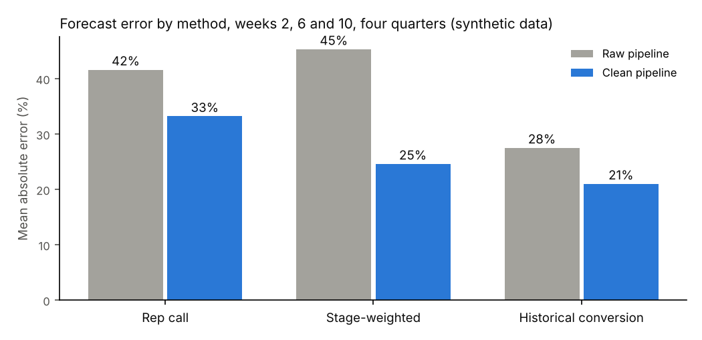
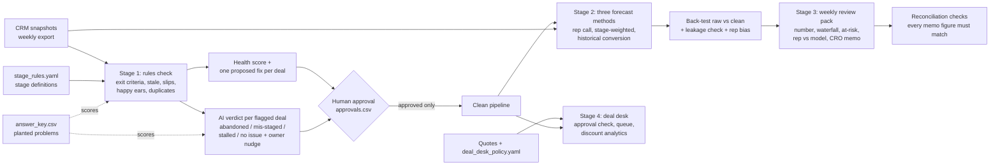
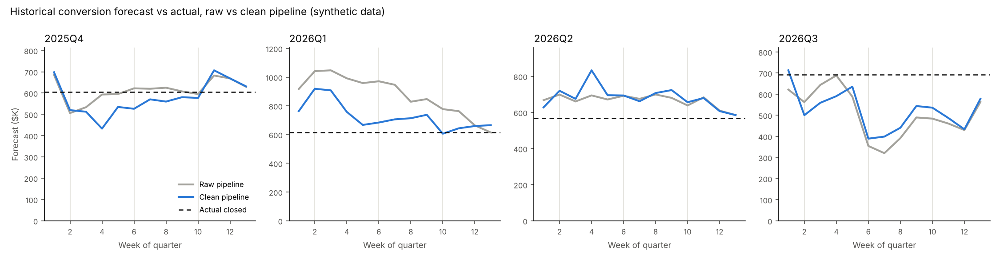
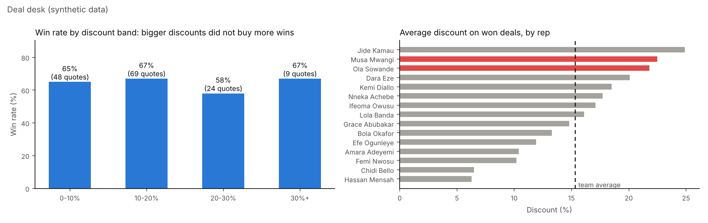

# Forecast Integrity System

**I make revenue forecasts trustworthy, and I prove it with the numbers.** This repo is a working system that audits a CRM pipeline against its own stage rules, forecasts the quarter three ways, back-tests every method, builds the weekly forecast review pack a CRO reads on Monday, and runs a deal desk that checks every quote against pricing and approval policy.

> All data in this repo is synthetic. Companies, people, deals and amounts are invented by `data/make_data.py`. No client data is used anywhere.

**Recruiter takeaway:** I can tell a revenue team why its forecast is wrong, fix the system underneath it, and show the forecast got better.

## Headline result

Same pipeline, same four quarters, same forecast methods. The only difference is whether the Stage 1 hygiene rules ran first.

| Forecast method | Error on raw CRM | Error after hygiene | Bias raw | Bias after hygiene |
| --- | --- | --- | --- | --- |
| Rep call (commit + half of best case) | 41.6% | 33.2% | +9.7% | -20.9% |
| Stage-weighted (amount x stage probability) | 45.3% | **24.6%** | +43.0% | +12.2% |
| Historical conversion (learned from earlier quarters) | 27.5% | **21.0%** | +8.2% | -0.1% |

Mean absolute error of 12 forecasts per method (weeks 2, 6 and 10 of four quarters, Q4 2025 to Q3 2026). A leakage check ran 624 times and confirmed no forecast ever used data from after its forecast date.



**The thesis this proves:** most forecast misses are data and process problems, not maths problems. Cleaning the pipeline cut stage-weighted error almost in half before any model got smarter.

**What I did for real (Plumemark Digitals client work):** scored open deals against stage exit criteria and data-completeness rules, then removed or re-staged deals that failed. That removed **$2.1M of phantom pipeline** and cut **forecast variance from 34% to under 10%**. In a separate CRM data-integrity audit I corrected or standardized about 1,700 of 4,200 records. Automating executive reporting cut **manual reporting by 78%**, from about a full day a week to under 30 minutes. This repo rebuilds those mechanisms on synthetic data so anyone can run them.

## The problem

Stages mean different things to different reps. Deals sit past their exit criteria, close dates slip quarter after quarter, and dead deals stay open because nobody wants to close them. Leadership gets one forecast number with no idea how reliable it is, and someone spends a day a week building the forecast report by hand. The forecast is wrong before anyone does any maths.

## How it works



1. **Data** (`data/make_data.py`). A seeded generator creates 354 deals for 15 reps across two segments, and 4,986 weekly snapshot rows from April 2025 to 2 November 2026. It plants the problems revenue teams live with and writes each one to `answer_key.csv` with the date it became true.
2. **Stage definitions** (`stage1_hygiene/STAGE_DEFINITIONS.md`, `data/stage_rules.yaml`). One page in plain English: what each stage means, its exit criteria, required fields, time limit and win probability. The rules check reads the YAML, so the document and the code can never disagree.
3. **Rules check** (`stage1_hygiene/rules_check.py`). Flags every open deal that fails exit criteria, is stale, has a past-due close date, has been pushed 3 or more times, sits in commit without a next step or decision maker, is missing an amount or close date, or duplicates an earlier record. Each flag costs health points and each flagged deal gets one fix, in plain words.
4. **AI verdict** (`stage1_hygiene/ai_verdict.py`). One call per deal with a process flag. The AI says why the deal is flagged (abandoned, mis-staged, stalled, or a false alarm) and drafts a short nudge to the owner. Data fixes (duplicates, missing fields) never go to the AI.
5. **Approval gate** (`stage1_hygiene/approvals.csv`). Nothing changes unless a person writes "approve" next to the deal. Approved fixes produce `outputs/stage1/pipeline_clean.csv`.
6. **Forecasts and back-test** (`stage2_forecast/`). Three methods, each run on the raw and the clean pipeline, at every week of four past quarters, using only the snapshot available on that date.
7. **Weekly review pack** (`stage3_review/build_pack.py`). The number with a range, a pipeline movement waterfall, deals at risk, rep call versus model call, and a one-page CRO memo. The script computes every number. The AI only writes the narrative, and reconciliation checks fail the pack if the memo contains any figure that is not in the computed facts.
8. **Deal desk** (`stage4_deal_desk/`). Every quote is checked against `data/deal_desk_policy.yaml`: who must approve a discount band, payment terms, free months, contract length and non-standard clauses. It also flags clauses promised in free-text notes that Legal never saw, approvals dated after the deal closed, quotes whose maths does not match the CRM amount, and deals signed on an expired quote. Open quotes go to an approval queue with the approver and their SLA.

## Stack

| Tool | Job | Cost |
| --- | --- | --- |
| Python 3.11+ with pandas, NumPy, PyYAML | Data, rules, forecasts | Free |
| matplotlib | Charts | Free |
| Markdown, ReportLab | Memo as HTML and PDF | Free |
| Claude API (optional) | Stage 1 verdicts, Stage 3 memo narrative in `--ai live` mode | Pay per use, under $1 for a full run |
| GitHub | Code and README | Free |

## Setup

1. Install Python 3.11 or newer.
2. Clone the repo and open a terminal in its folder:
   ```bash
   git clone https://github.com/FeyisayoDaisi/revops-forecast-integrity.git
   cd revops-forecast-integrity
   python -m venv .venv && source .venv/bin/activate   # Windows: .venv\Scripts\activate
   pip install -r requirements.txt
   ```
3. Optional, only for live AI calls: `pip install anthropic` and set `ANTHROPIC_API_KEY`. Without a key the system replays the saved AI responses in `outputs/stage1/ai_cache.jsonl` and `outputs/stage3/memo_ai_cache.json`.

Field names the rules expect in a CRM export (one row per deal per weekly snapshot): `snapshot_date, deal_id, account_name, owner, segment, stage, stage_entered_date, amount, close_date, forecast_category (commit | best_case | pipeline), created_date, last_activity_date, next_step, pain_confirmed, decision_maker_identified, budget_confirmed, paper_process_known`. In HubSpot the closest standard properties are `dealstage`, `amount`, `closedate`, `hs_manual_forecast_category`, `hs_lastmodifieddate` or `notes_last_contacted`, and `hs_next_step`; the qualification booleans are custom properties.

## Usage

Run everything (about 20 seconds):

```bash
python run_all.py            # replay saved AI responses
python run_all.py --ai live  # call Claude instead (needs ANTHROPIC_API_KEY)
```

Or one stage at a time:

```bash
python data/make_data.py
python stage1_hygiene/run_stage1.py --approvals stage1_hygiene/approvals.csv   # your own decisions
python eval/eval_stage1.py
python stage2_forecast/backtest.py
python stage3_review/build_pack.py
python data/make_quotes.py
python stage4_deal_desk/deal_desk.py
```

The first Stage 1 run writes `stage1_hygiene/approvals.csv` with an empty `decision` column. Fill in `approve` or `reject` per deal and run Stage 1 again with `--approvals stage1_hygiene/approvals.csv`. The shipped outputs use `approvals_demo.csv`, a documented demo policy: approve every fix unless the AI judged the flag a false alarm.

**Sample input:** `data/deals_snapshots.csv` (one row per deal per week).

**Main outputs:**

| File | What is in it |
| --- | --- |
| `outputs/stage1/flagged_deals.csv` | deal, owner, stage, amount, close date, category, health score (0 to 100), flag reasons, proposed fix, AI verdict, AI reason, owner nudge, recommendation |
| `outputs/stage1/data_health_scorecard.csv` | before and after: open deals, complete records %, meeting exit criteria %, stale %, past due %, commit amount, weighted in-quarter pipeline |
| `outputs/stage1/pipeline_clean.csv` | the pipeline after approved fixes, with `fix_applied` and `in_forecast` columns |
| `outputs/stage1/eval_*.csv` | precision, recall and false-positive rate per detector, AI confusion matrix, every miss |
| `outputs/stage2/accuracy_table.csv` | mean absolute error, bias and worst error per method, raw vs clean |
| `outputs/stage2/accuracy_by_week.csv` | the same by week of quarter |
| `outputs/stage2/rep_bias.csv` | per rep: commit conversion %, share of wins hidden in pipeline category, pattern |
| `outputs/stage2/forecast_vs_actual.png` | every week's forecast against what closed, four quarters |
| `outputs/stage3/review_pack.html` | the weekly pack in one page |
| `outputs/stage3/forecast_memo.md` / `.pdf` | the CRO memo |
| `outputs/stage3/reconciliation.csv` | pass or fail per check |
| `outputs/stage4/quote_checks.csv` | every quote: approvals needed, approvals obtained, approvals missing, hard breaks, policy breaks |
| `outputs/stage4/approval_queue.csv` | open quotes waiting on an approver: who, why and the SLA in hours |
| `outputs/stage4/discount_by_rep.csv` | won deals, average discount, points above the team average, flag |
| `outputs/stage4/summary.json` | discount analytics, revenue on unapproved terms, forecast link, evaluation |

## Results

### Stage 1: rules check (five audit dates, 316 deal reviews)

Scored against the answer key at week 6 of each back-test quarter and on 2 November 2026.

| Detector | Caught | False alarms | Missed | Precision | Recall |
| --- | --- | --- | --- | --- | --- |
| Missing exit criteria | 24 | 0 | 2 | 100% | 92% |
| Stale (no activity 45+ days, Solution or later) | 61 | 1 | 16 | 98% | 79% |
| Past-due close date | 89 | 2 | 0 | 98% | 100% |
| Serial slipper (3+ pushes) | 17 | 0 | 0 | 100% | 100% |
| Happy ears (commit, no next step or decision maker) | 18 | 0 | 0 | 100% | 100% |
| Missing amount or close date | 7 | 0 | 0 | 100% | 100% |
| Duplicate | 19 | 0 | 3 | 100% | 86% |
| **Any problem, deal level** | **126** | **3** | **4** | **98%** | **97%** |

**What it missed, and why:**
- **16 abandoned deals were not yet stale.** The buyer had gone quiet, but for fewer than 45 days. The rule cannot see a deal die until the silence is long enough. Most of these were still caught at deal level by their past-due close date.
- **3 duplicates were retyped by hand** with a slightly different amount (for example $28,028 against $28,600), so the exact-match rule missed them. Fuzzy matching on amount is the obvious next step, at the cost of more false alarms on genuine expansion deals.
- **2 mis-staged deals had their boxes ticked.** The rep marked the qualification fields true without the evidence. No field-based rule can catch that; it needs a conversation.

On 2 November 2026, 24 of 67 open deals were flagged. Approving the fixes took commit from **$244,500 to $73,500** and weighted Q4 pipeline from **$629,560 to $541,110**.

### Stage 1: AI verdict step (104 flagged deals)

| AI verdict | Correct | Wrong | Missed | Precision | Recall |
| --- | --- | --- | --- | --- | --- |
| Abandoned | 66 | 0 | 10 | 100% | 87% |
| Mis-staged | 6 | 2 | 2 | 75% | 75% |
| Stalled | 16 | 11 | 1 | 59% | 94% |
| No issue (rule false alarm) | 1 | 2 | 2 | 33% | 33% |

Overall agreement with the answer key: **85.6%**. When the AI said "abandoned" it was right every time. Its main miss is the same blind spot as the rules: 9 recently abandoned deals were called "stalled" because they still had recent activity and a passed close date. That is a reasonable read of the evidence, and it is why a person approves every fix.

**How the saved AI responses were made:** the 104 verdicts in `outputs/stage1/ai_cache.jsonl` were produced by a Claude model (Sonnet) in a blind batch run on 7 November 2026, from exactly the prompts this code builds, without access to the answer key. `--ai live` regenerates them through the API.

### Stage 2: back-test

See the headline table above. Two more findings:
- **The rep call on clean data under-forecasts** (bias -20.9%), because cleaning downgrades commit without adding the deals reps sandbag. Rep judgment needs the rep-bias table next to it.
- **Rep bias** (`rep_bias.csv`) found both planted sandbaggers (100% and 60% of their wins sat in pipeline category while in Proposal or Negotiation) and one of the two planted optimists. It also flagged two reps whose commit rarely closed because their commits included dead deals, a reminder to clean the data before judging the people. 12 of 15 reps were classified correctly.



### Stage 3: weekly review pack (Q4 2026, week 5)

- Recommended forecast **$559,000** (historical conversion on the clean pipeline) against a **$590,000** target, range **$433,000 to $685,000**. The rep call on the raw CRM is $355,400.
- 9 in-quarter deals worth $412,200 fail the stage rules. Rep call and model call disagree by more than 25% and $20,000 for 5 reps, including one rep calling $0 while the model sees $113,200.
- **Reconciliation: 5 of 5 checks pass.** All 17 figures in the memo match the computed facts, the waterfall adds up from $2,490,400 to $2,383,600, and deal-level movements match the totals.
- **Memo rubric: 3 of 3 pass** (accurate, explains the change, names actions).

### Stage 4: deal desk (162 quotes)

| Policy break | Planted | Caught | False alarms | Missed | Recall |
| --- | --- | --- | --- | --- | --- |
| Missing approval | 13 | 12 | 1 | 1 | 92% |
| Discount above the 40% ceiling | 7 | 7 | 0 | 0 | 100% |
| Clause promised in notes, Legal never saw it | 11 | 8 | 1 | 3 | 73% |
| Approval dated after the deal closed | 14 | 14 | 0 | 0 | 100% |
| Quote maths does not match the CRM amount | 2 | 2 | 0 | 0 | 100% |
| Deal signed on an expired quote | 9 | 9 | 0 | 0 | 100% |
| **Any break, quote level** | **56** | **54** | **0** | **2** | **96%** |

**What the check missed:** two deals where the rep wrote "they can walk away at month 6" instead of naming termination for convenience. Keyword rules cannot read intent; this is the obvious place for an AI step with a person checking it. The one missing-approval false alarm came from a note that said "standard SLA applies", which the clause rule read as a promise.

**What the analytics found (synthetic data):**
- Won deals averaged a **15.3%** discount, rising to **19.1%** in the last two weeks of the quarter against **14.5%** the rest of the time.
- **$1,077,830** of list price was given away on **$4,208,500** of won revenue.
- **24 won deals worth $872,800** closed on terms that were never properly approved.
- Win rate was flat across discount bands (65%, 67%, 58%, 67%), so bigger discounts did not buy more wins.
- Two reps discount at least 5 points above the team on 5 or more won deals. One of the two planted discounters is caught; the other sits 4.8 points above, just under the line.
- This quarter, one in-forecast deal worth $140,000 sits on a quote still waiting on Finance, and 3 open quotes are in the approval queue.



## Design notes

- **One fix per deal, most important first.** A duplicate is merged before anyone argues about its stage. Owners get one clear ask, not a list.
- **The AI never touches a number or the CRM.** In Stage 1 it classifies and drafts; in Stage 3 it writes narrative from computed facts, and the reconciliation check fails the pack if it invents a figure.
- **One AI call per item, temperature 0, 3 retries, no loops, no tools.** Broken AI output falls back to `needs_review` instead of crashing.
- **Human approval before any write.** The approval file is plain CSV so a RevOps lead can review it in a spreadsheet.
- **Rules live in YAML, not code.** Changing a stage time limit or win probability is a one-line edit a non-engineer can make.
- **Leakage is checked, not assumed.** Every data access in the back-test is logged and checked against the forecast date.
- **Seniority counts in approvals.** A CRO signing a manager-level discount is valid, so the check accepts a more senior sales approver. Finance and Legal cannot be covered by anyone else.
- **A rep is only flagged with enough evidence:** 5 or more won deals and 5 or more points above the team average.
- **Errors are shown, not hidden.** Every miss is listed in `outputs/stage1/eval_rules_misses.csv` and `eval_ai_disagreements.csv`.

## Troubleshooting

Real errors from building this:

| Error | Cause | Fix |
| --- | --- | --- |
| `make_data.py` hung with no output | The account-name generator had 308 possible names for 340 deals, so the uniqueness loop never ended | Added a third name part (Ltd, Group, Co) for 924 possible names |
| Planted problems clustered on the same deals | Every problem was picked from the same shuffled list, so the first deals got several problems each | Each problem now draws from its own fresh shuffle |
| Duplicate recall was 29% | The rule only compared open deals, so a duplicate whose original had already closed was never matched | The rule now checks every record in CRM history |
| Reconciliation failed on a correct memo | The figure regex captured the comma after "$590,000," | Tightened the regex to thousands groups only |
| Negative amounts printed as "$-75,000" | Default number formatting | `money()` now writes "-$75,000" |
| Stage 4 approval queue was empty | Almost no open quotes broke policy, because breaks were planted at the same rate on every quote | Planted more breaks on open quotes, since the live quarter is where a deal desk works |
| Stage 4 miss list showed each miss twice | False negatives and false alarms were collected in two passes over the same rows | Dropped duplicates before writing the file |
| Rep bias table blamed the wrong reps | One snapshot per quarter gave too few deals per rep | Measured across weeks 2, 6 and 10, and required at least 3 commit deals before calling a rep optimistic |

## Privacy and compliance

- The repo processes no personal data: every name is invented.
- On real CRM data, the system reads deal records and owner names. In live mode, flagged deal facts (stage, dates, amounts, next-step text, owner name) are sent to the Claude API. Strip free-text fields or contact names first if your data policy requires it.
- For EU or UK data, the lawful basis is usually legitimate interest in managing your own sales pipeline. Record that in your data processing register and keep the export inside your approved processors.
- The system drafts nudges and proposed fixes but never sends or writes anything. A person approves every change.
- In regulated industries (for example healthcare clients under HIPAA), keep protected data out of CRM free-text fields entirely. I have built that constraint into client revenue systems before, and the same rule applies here: the AI step should only ever see sales-process facts.

## Limitations

- Synthetic data is cleaner than reality. Real CRMs have more kinds of mess (custom stages, multi-currency, merged accounts).
- With 354 deals, each back-test quarter closes 13 to 18 won deals, so one large deal moves the error a lot. Read the error figures as directional.
- In the back-test, Stage 1 fixes are applied automatically, because human approval cannot happen in the past. Live use would apply only approved fixes.
- The historical method needs at least two prior quarters of weekly snapshots. A team without snapshot history should start saving them now.
- The stale rule cannot see a deal die until 45 days of silence. Shorter thresholds catch more zombies and flag more healthy deals.
- Rep-bias calls are unreliable for reps with fewer than three commit deals in the period.

## What I would add in production

- A HubSpot or Salesforce connector that saves a snapshot every Monday, since snapshot history is what makes back-testing possible.
- Owner nudges posted to Slack after approval, with a reply button for "object".
- Fuzzy duplicate matching on account name and amount.
- Segment-level conversion rates once there is enough history.
- A weekly accuracy tracker that compares last quarter's call with what closed, so the forecast earns trust over time.

## Repo map

```
data/              make_data.py, make_quotes.py, stage_rules.yaml, deal_desk_policy.yaml, synthetic CSVs, answer keys
stage1_hygiene/    stage definitions, rules check, AI verdict step, approvals
stage2_forecast/   three forecast methods, back-test, leakage check, rep bias
stage3_review/     weekly pack, waterfall, memo, reconciliation checks
stage4_deal_desk/  pricing and approval policy check, approval queue, discount analytics
eval/              Stage 1 evaluation against the answer key
outputs/           every output file, regenerated by run_all.py
docs/              one-page write-ups per stage
```

Related: [revops-forecast-reasoning-eval](https://github.com/FeyisayoDaisi/revops-forecast-reasoning-eval) tests whether AI explanations of this forecast are correct, not just fluent.

Built by **Feyisayo Daisi**, Revenue Systems Architect. [LinkedIn](https://www.linkedin.com/in/feyisayo-daisi-1ba481191) · feyisayodaisi@gmail.com
